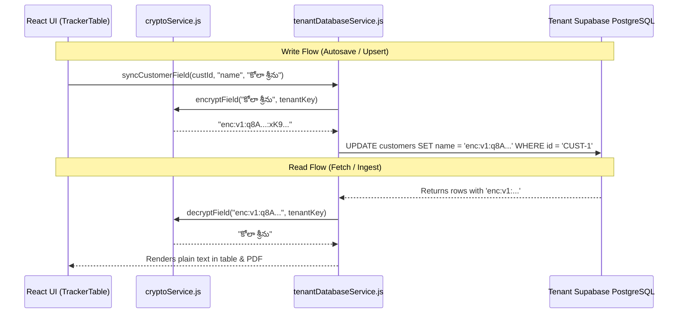

# FinRoute Collect — Tenant Database Encryption Architecture & Implementation Plan

> **Document Version:** 1.0  
> **Target System:** FinRoute Dedicated Tenant Supabase PostgreSQL Databases  
> **Status:** Draft / Planned Implementation  
> **Objective:** Provide field-level and column-level encryption for sensitive borrower records (names, phone numbers, disbursement values) within isolated tenant databases.

---

## 1. Executive Summary & Security Objectives

In a multi-tenant microfinance ledger platform, tenant customer records contain sensitive Personal Identifiable Information (PII) and financial records:
- **Borrower Names** (Telugu / English script)
- **Phone Numbers**
- **Disbursed Loan Amounts**
- **Weekly Repayment History**

While Supabase PostgreSQL automatically encrypts data **in transit (TLS 1.3)** and **at rest (AES-256 disk encryption)**, adding **Field-Level / Zero-Knowledge Encryption** guarantees that even database administrators or anyone inspecting the raw PostgreSQL tables cannot read sensitive borrower details in plain text.

---

## 2. Encryption Approaches Comparison

| Architecture | Encryption Location | Key Custody | Pros | Cons | Recommendation |
|---|---|---|---|---|:---:|
| **Approach A: Client-Side Zero-Knowledge (AES-GCM)** | Browser (React Frontend via Web Crypto API) | Tenant credentials + Master salt | • True zero-knowledge<br>• Database host never sees plain text<br>• No database CPU overhead | Key loss requires backup recovery key | ⭐ **Recommended** |
| **Approach B: PostgreSQL Server-Side (`pgcrypto`)** | Database Engine (PostgreSQL functions) | PostgreSQL Server session / Function arg | • Centralized in DB<br>• Can query via SQL triggers | Passphrase must be passed over network or stored in DB vault | Alternative |

---

## 3. Approach A: Client-Side Zero-Knowledge Encryption (Recommended)

### 3.1. Cryptographic Specifications
- **Algorithm:** AES-GCM (Galois/Counter Mode) with 256-bit key length.
- **Key Derivation:** PBKDF2 (Password-Based Key Derivation Function 2) with SHA-256, 100,000 iterations.
- **Initialization Vector (IV):** 12-byte cryptographically secure random bytes (`crypto.getRandomValues`) per encrypted field to prevent replay and frequency analysis attacks.
- **Ciphertext Format:** Prefixed Base64 string for easy backward compatibility:
  ```text
  enc:v1:<base64-iv>:<base64-ciphertext>
  ```

### 3.2. Implementation Architecture



### 3.3. Module Specifications

#### File 1: `src/utils/cryptoService.js`
Responsible for key derivation, encryption, and decryption using the standard browser `window.crypto.subtle` API:

```javascript
/**
 * Derives a 256-bit AES-GCM CryptoKey from the tenant's password and salt.
 */
export async function deriveTenantKey(password, email) {
  const enc = new TextEncoder();
  const keyMaterial = await window.crypto.subtle.importKey(
    'raw',
    enc.encode(password),
    { name: 'PBKDF2' },
    false,
    ['deriveKey']
  );

  return await window.crypto.subtle.deriveKey(
    {
      name: 'PBKDF2',
      salt: enc.encode(`FINROUTE_${email.toLowerCase().trim()}`),
      iterations: 100000,
      hash: 'SHA-256'
    },
    keyMaterial,
    { name: 'AES-GCM', length: 256 },
    false,
    ['encrypt', 'decrypt']
  );
}

/**
 * Encrypts a string value into an 'enc:v1:iv:ciphertext' string.
 */
export async function encryptField(plainText, cryptoKey) {
  if (!plainText && plainText !== 0) return plainText;
  const enc = new TextEncoder();
  const iv = window.crypto.getRandomValues(new Uint8Array(12));
  
  const cipherBuffer = await window.crypto.subtle.encrypt(
    { name: 'AES-GCM', iv },
    cryptoKey,
    enc.encode(String(plainText))
  );

  const ivB64 = btoa(String.fromCharCode(...iv));
  const cipherB64 = btoa(String.fromCharCode(...new Uint8Array(cipherBuffer)));
  return `enc:v1:${ivB64}:${cipherB64}`;
}

/**
 * Decrypts an 'enc:v1:iv:ciphertext' string back to plain text.
 * Gracefully returns original text if not encrypted (backward compatible).
 */
export async function decryptField(encryptedText, cryptoKey) {
  if (typeof encryptedText !== 'string' || !encryptedText.startsWith('enc:v1:')) {
    return encryptedText; // Legacy unencrypted value
  }

  try {
    const [, , ivB64, cipherB64] = encryptedText.split(':');
    const iv = new Uint8Array(atob(ivB64).split('').map(c => c.charCodeAt(0)));
    const cipherBytes = new Uint8Array(atob(cipherB64).split('').map(c => c.charCodeAt(0)));

    const decryptedBuffer = await window.crypto.subtle.decrypt(
      { name: 'AES-GCM', iv },
      cryptoKey,
      cipherBytes
    );

    return new TextDecoder().decode(decryptedBuffer);
  } catch (err) {
    console.warn('Field decryption error:', err);
    return '[Decryption Error]';
  }
}
```

---

## 4. Approach B: PostgreSQL Server-Side (`pgcrypto`)

If encryption should be performed by PostgreSQL itself (so Supabase SQL functions can decrypt data):

### 4.1. SQL Extension Setup
```sql
-- Run inside Tenant Dedicated Database SQL Editor
CREATE EXTENSION IF NOT EXISTS pgcrypto;

-- Alter column types if binary storage preferred
ALTER TABLE customers 
  ALTER COLUMN name TYPE TEXT,
  ALTER COLUMN phone TYPE TEXT;
```

### 4.2. Stored Function for Encrypted Insert/Update
```sql
CREATE OR REPLACE FUNCTION tenant_upsert_customer_secure(
    p_id VARCHAR(100),
    p_name TEXT,
    p_phone TEXT,
    p_disbursed NUMERIC,
    p_passphrase TEXT
)
RETURNS VOID AS $$
BEGIN
    INSERT INTO customers (id, name, phone, disbursed, updated_at)
    VALUES (
        p_id,
        pgp_sym_encrypt(p_name, p_passphrase),
        pgp_sym_encrypt(p_phone, p_passphrase),
        p_disbursed,
        NOW()
    )
    ON CONFLICT (id) DO UPDATE SET
        name = pgp_sym_encrypt(p_name, p_passphrase),
        phone = pgp_sym_encrypt(p_phone, p_passphrase),
        disbursed = p_disbursed,
        updated_at = NOW();
END;
$$ LANGUAGE plpgsql SECURITY DEFINER;
```

---

## 5. Backward Compatibility & Migration Strategy

To avoid corrupting existing customer records already in the tenant database:
1. **Graceful Inspection**:
   Before attempting decryption, check `if (field.startsWith('enc:v1:'))`. If not, treat as plain text. This ensures older unencrypted records continue rendering seamlessly.
2. **One-Time Re-encryption Pass**:
   Provide a utility in the Admin Panel or Tenant Settings:
   - Pulls all records.
   - Checks for rows where `!name.startsWith('enc:v1:')`.
   - Encrypts and saves back in batch chunks of 50.

---

## 6. Tenant Password Change & Key Management

When a tenant changes their login password:
1. **Option 1 (Derived Key Rotation)**:
   The client fetches all customer records using the old password, decrypts into memory, re-derives the new AES key from the new password, encrypts all records, and saves them back to Supabase.
2. **Option 2 (Envelope Encryption - Recommended for Scale)**:
   - A random 256-bit **Data Encryption Key (DEK)** is generated for the tenant.
   - The DEK encrypts customer data.
   - The DEK is itself encrypted by the tenant's password (**Key Encryption Key / KEK**) and stored in `master_db_configs`.
   - When changing password, only the DEK needs to be re-wrapped with the new password—customer rows do not need to be modified!

---

## 7. Implementation Checklist (When Ready to Execute)

- [ ] Create [src/utils/cryptoService.js](file:///c:/Users/genai/Downloads/Sheet/tracker-app/src/utils/cryptoService.js) with Web Crypto API helpers.
- [ ] Initialize tenant `CryptoKey` in [src/App.jsx](file:///c:/Users/genai/Downloads/Sheet/tracker-app/src/App.jsx) upon successful login.
- [ ] Wrap customer `name` and `phone` in [src/services/tenantDatabaseService.js](file:///c:/Users/genai/Downloads/Sheet/tracker-app/src/services/tenantDatabaseService.js) on `syncCustomerFieldToTenantDb`, `addTenantCustomer`, and `migrateSheetDataToTenantDb`.
- [ ] Add decrypt mapping in `fetchTenantLedgerData`.
- [ ] Verify Telugu script rendering (`UTF-8` character boundaries) after encryption and decryption cycles.
- [ ] Verify that CSV and PDF exports decrypt records seamlessly before document generation.
- [ ] Add one-click "Encrypt Legacy Records" button in tenant settings.
