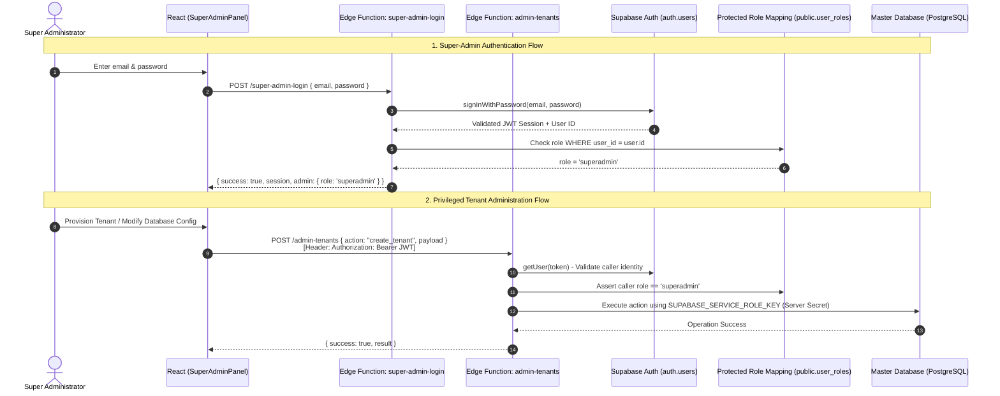

# FinRoute Collect — Super-Admin Supabase Auth & Edge Functions Architecture

> **Security Upgrade Documentation**  
> **Status:** Production Ready  
> **Target:** Master Supabase Database & Edge Functions  

---

## 📌 Architectural Overview

Super-Admin operations have been hardened and migrated from direct database table queries to **Supabase Auth + Authenticated Edge Functions** with a **Protected Role Mapping**:



---

## 🔒 Key Security Guarantees

1. **Privileged Keys Server-Side Only**:
   - `SUPABASE_SERVICE_ROLE_KEY` is **never** bundled or exposed to the frontend.
   - It is retrieved strictly from the server-side environment secrets (`Deno.env.get('SUPABASE_SERVICE_ROLE_KEY')`).
   - The React client only retains the publishable `VITE_MASTER_SUPABASE_ANON_KEY`.

2. **Role Enforcement on Every Request**:
   - The Edge Function `admin-tenants` extracts the JWT Bearer token on **every single request**, validates it via Supabase Auth, and verifies that `public.user_roles` contains `role = 'superadmin'` for that user ID.
   - Any unauthenticated or non-superadmin caller receives an immediate `401 Unauthorized` or `403 Forbidden`.

3. **Protected Role Mapping**:
   - The `public.user_roles` table is protected by Row Level Security (RLS).
   - Regular authenticated users can only read their own role.
   - Modifying or inserting roles is strictly restricted to the `service_role` key inside the Edge Function or `SECURITY DEFINER` procedures.

4. **Elimination of Public Table Queries**:
   - Removed the legacy `Allow anon read super admins` policy on `master_super_admins`.
   - Prevented anonymous users from listing tenants or reading database configurations directly from the frontend.

---

## 🛠️ Step-by-Step Deployment Instructions

### Step 1: Execute SQL Migration on Master Supabase Database
1. Open your Master Supabase Project Dashboard:  
   👉 [https://supabase.com/dashboard/project/ubhwoicsjmxslggltvaa/sql](https://supabase.com/dashboard/project/ubhwoicsjmxslggltvaa/sql)
2. Open the SQL Editor and paste the contents of:  
   `supabase/migrations/20261026_super_admin_auth_migration.sql`
3. Click **Run**.  
   *What this does:*
   - Creates `public.user_roles` and enforces RLS.
   - Creates the `is_super_admin()` security definer function.
   - Migrates existing accounts from `master_super_admins` into Supabase `auth.users` with confirmed email addresses.
   - Provisions the default root admin (`admin@finroute.com` / `FinRoute@Master2026!`).
   - Drops insecure anonymous read policies.

---

### Step 2: Configure Server-Side Secrets
In your local terminal with the Supabase CLI installed:

```bash
# Set server secrets for your master Supabase project
npx supabase secrets set --project-ref ubhwoicsjmxslggltvaa \
  SUPABASE_SERVICE_ROLE_KEY="YOUR_MASTER_SERVICE_ROLE_KEY"
```

> [!TIP]
> You can find your `SUPABASE_SERVICE_ROLE_KEY` in:
> **Supabase Dashboard** > **Project Settings** > **API** > **Project API keys** > `service_role (secret)`.

---

### Step 3: Deploy the Edge Functions

Deploy the two new Edge Functions to your Master Supabase project:

```bash
# 1. Deploy the Super-Admin Login function
npx supabase functions deploy super-admin-login --project-ref ubhwoicsjmxslggltvaa

# 2. Deploy the Tenant Administration function
npx supabase functions deploy admin-tenants --project-ref ubhwoicsjmxslggltvaa
```

---

## 📁 Files Created & Modified

| File | Change Type | Description |
|---|---|---|
| [`supabase/migrations/20261026_super_admin_auth_migration.sql`](file:///d:/Sheet/tracker-app/supabase/migrations/20261026_super_admin_auth_migration.sql) | **Created** | SQL migration script for `public.user_roles`, `is_super_admin()`, and account migration to `auth.users`. |
| [`supabase/supabase_master_setup.sql`](file:///d:/Sheet/tracker-app/supabase/supabase_master_setup.sql) | **Updated** | Added `user_roles`, secure RLS, and `SECURITY DEFINER` to `verify_tenant_login`. |
| [`supabase/functions/_shared/cors.ts`](file:///d:/Sheet/tracker-app/supabase/functions/_shared/cors.ts) | **Created** | Reusable CORS preflight handler & JSON response utilities. |
| [`supabase/functions/_shared/auth.ts`](file:///d:/Sheet/tracker-app/supabase/functions/_shared/auth.ts) | **Created** | Server-side JWT validator and `superadmin` role verifier. |
| [`supabase/functions/super-admin-login/index.ts`](file:///d:/Sheet/tracker-app/supabase/functions/super-admin-login/index.ts) | **Created** | Edge Function for super-admin login via Supabase Auth. |
| [`supabase/functions/admin-tenants/index.ts`](file:///d:/Sheet/tracker-app/supabase/functions/admin-tenants/index.ts) | **Created** | Edge Function executing tenant provisioning, admin creation, status updates, and stats with role checks. |
| [`src/services/masterAuthService.js`](file:///d:/Sheet/tracker-app/src/services/masterAuthService.js) | **Updated** | Refactored client service to call Edge Functions with active Supabase Auth JWT and graceful fallback. |
| [`src/components/SuperAdminPanel.jsx`](file:///d:/Sheet/tracker-app/src/components/SuperAdminPanel.jsx) | **Updated** | Updated to use `getSuperAdminSession()`, `logoutSuperAdmin()`, and encrypted auth status. |
| [`src/components/SuperAdminModals.jsx`](file:///d:/Sheet/tracker-app/src/components/SuperAdminModals.jsx) | **Updated** | Updated Add Admin modal copy to reflect Supabase Auth integration. |
